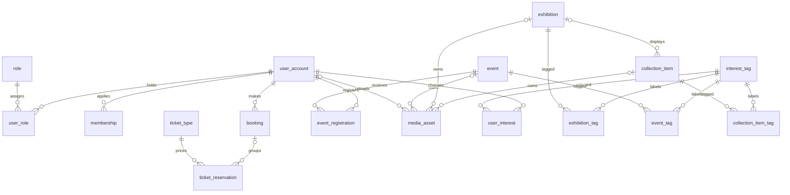

# Core entity relationships

This diagram summarizes the implemented relationships; ordered migrations are
the authoritative DDL. See [schema notes](schema-notes.md) for operations.
Optional relationships are described below rather than hidden by display order.

`media_asset` belongs to exactly one of collection item, exhibition or event;
the three optional owner edges are mutually exclusive, enforced by a CHECK.
Its uploader may be null. A collection item may have no exhibition. Legacy
ticket reservations can have no booking; new booking lines are grouped by the
unique booking reference. Media IDs, record IDs and booking references are
separate identifiers. PostgreSQL stores object URLs; Supabase/R2 store bytes.

Reference/operations tables not expanded here include `museum_information`,
`facility`, opening hours/overrides, `activity_log` and `schema_migrations`.
