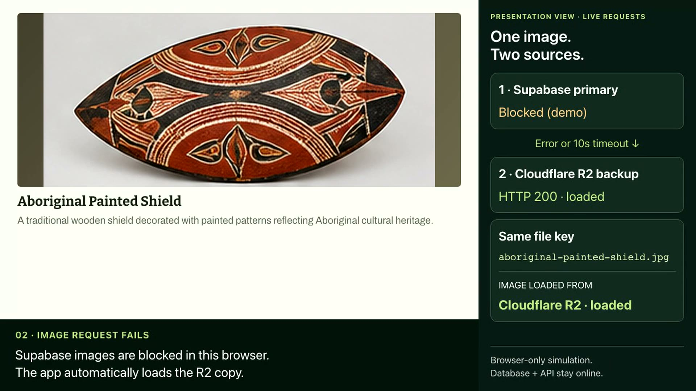

# Supabase → Cloudflare R2 image failover demo

[](supabase-r2-failover.mp4)

**[Download / watch the MP4](supabase-r2-failover.mp4)** · English on-screen captions · 1920 × 1080 · silent, suitable for live presentation narration.

Duration: **87.92 seconds**. The H.264 MP4 is about **4.4 MB**. Optional editable
[subtitle sidecar](supabase-r2-failover.srt) is included; captions are already
visible in the video.

This is a recording of the deployed Regional Museum Platform using the real
**Aboriginal Painted Shield** record and its real Supabase and R2 image objects.
The side panel and captions are clearly labeled presentation overlays. The panel
observes the actual target-image requests and the image element's rendered source.
It is not an administration screen shipped with the application.

### Readable presentation edition

The main captions and source-status text are **36 pixels in the final video**.
Captions use short two-line prompts, with longer pauses for live narration.
A recording-only presentation view enlarges the live image and hides navigation,
metadata tables and related cards. Full storage hostnames remain in the evidence
file instead of using tiny text in the video. Capture is composed at 1280 × 720
and exported to 1920 × 1080 so the visible text occupies more of the screen.

## What happens

1. **Normal read:** the real API returns a Supabase public image URL. The picture
   loads from Supabase and the panel shows its successful HTTP response.
2. **Primary image request error:** this isolated browser blocks Supabase Storage
   requests. `MediaImage` automatically tries the same object key in Cloudflare R2;
   the real R2 response succeeds and the same picture remains available.
3. **Primary image request hangs:** the browser holds the request open. The
   application's ten-second deadline triggers R2 fallback without waiting for a
   network error.
4. **Recovery:** remove the simulated block and reload. A fresh page/image attempt
   starts at Supabase again. This is reload-based recovery, not a background switch
   of an already-loaded R2 image.

The object key is `aboriginal-painted-shield.jpg` in both providers. The client
maps only the configured project's public `museum-media` image URLs to R2, then
tries each source once. If both attempts fail, it displays an unavailable state.

## Presentation notes

- “Our database stores the primary image URL. Supabase Storage serves the image;
  Cloudflare R2 contains a separate mirrored copy.”
- “Now I simulate failure of the image request in this browser. The site itself
  changes the image source to R2: no manual URL rewrite is involved.”
- “A stalled request is handled too. After ten seconds, the browser component
  tries the R2 copy.”
- “When we remove the block and reload, Supabase becomes the primary again.”
- “This protects image reads. It does not replace PostgreSQL or switch uploads.”

## Scope and limitations

**No provider was shut down.** Faults were injected only by Playwright routing in a
fresh, signed-out browser context. The API and Supabase PostgreSQL stayed online.
No cloud settings, records, files, credentials or existing user sessions changed.
The recorder rejects non-GET/HEAD API requests.

The R2 object must already exist at the matching key. The project's scheduled
mirror runs daily; newly uploaded photos are not instantly replicated. Image
fallback cannot rescue a page that cannot obtain its records because PostgreSQL
or the API is unavailable. Upload failover and database recovery are separate
operator workflows. See [the media operations runbook](../runbooks/media-ops.md).

## Evidence and reproduction

[Recording evidence](supabase-r2-failover-evidence.json) contains the public image
request events, successful rendered-source assertions, chapter timestamps and
observed timeout. It contains no credentials. The source recorder is
[record_media_failover.mjs](../../tests/e2e/record_media_failover.mjs).

Prerequisites: Node.js, the Node Playwright package with Chromium and its video
encoder available, and `ffmpeg`/`ffprobe` with H.264 encoding. The public shield record and
both existing storage copies must be available. No account or storage key is
needed.

From the repository root:

```bash
node tests/e2e/record_media_failover.mjs
```

The default site is `https://regional-museum-platform.pages.dev`. Optional:

- `E2E_BASE_URL`: another deployment containing the same public record.
- `API_BASE_URL`: the matching API for the initial read-only warmup (defaults
  to the existing Render API). Warmup happens before video capture begins.
- `PLAYWRIGHT_MODULE_PATH`: absolute `index.mjs` path for Playwright installed
  outside the repository.
- `PLAYWRIGHT_EXECUTABLE_PATH`: an existing compatible Chromium executable.
- `PLAYWRIGHT_BROWSERS_PATH`: Playwright's browser/video-encoder cache, if needed.
- `FFMPEG_BIN`: the conversion encoder executable (default `ffmpeg`).
- `FFPROBE_BIN`: the video inspection executable (default `ffprobe`).
- `MEDIA_DEMO_WORK_DIR`: raw video and screenshots (default ignored
  `backups/media-failover-recording`).
- `MEDIA_DEMO_OUT`: final MP4, poster, subtitles and evidence (default `docs/demos`).

Raw WebM captures are deliberately excluded from the repository. Re-running the
recorder replaces the presentation outputs and performs read-only browser checks.
