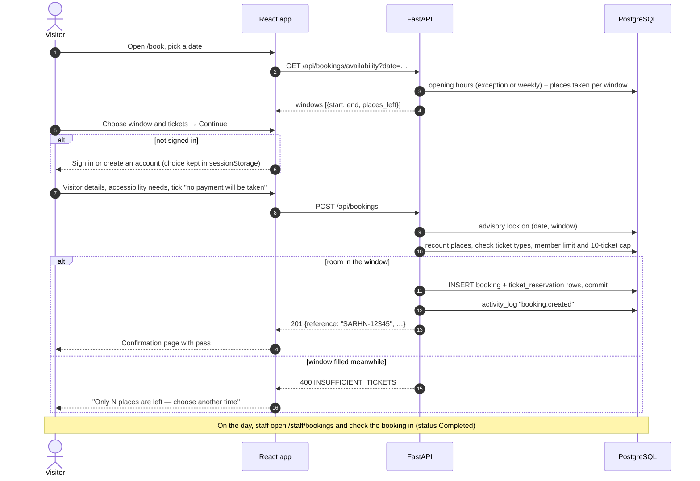

# Booking flow — general admission with simulated payment

Rules enforced by the server (`booking_service.py`):

| Rule | Response |
|---|---|
| Payment acknowledgement ticked | 400 otherwise |
| 1–10 tickets per booking | 409 `BOOKING_LIMIT_EXCEEDED` |
| Member tickets only with an active membership, up to the people it covers | 403 / 400 |
| Window offered on that date (open day, not passed, ≤ 60 days ahead) | 400 |
| Places left ≥ tickets, checked under a per-window lock | 400 `INSUFFICIENT_TICKETS` |
| Cancel only a `reserved` booking; places return to sale | 409 otherwise |

The lock is proven by `tests/load/race_last_places.py`: 40 simultaneous
two-ticket bookings for a 60-place window produce exactly 30 bookings.
