# Data model

Generated from the migrated database (`database/migrations/001`–`011`), so it
matches what the API actually reads and writes. Column-level notes and the
migration history are in `database/schema-notes.md`.

## Entity–relationship diagram

```mermaid
erDiagram
    activity_log {
        int activity_id PK
        timestamptz created_at
        int actor_user_id FK
        varchar actor_name
        varchar actor_role
        varchar action
        varchar target
        text reason
        varchar reference
        int subject_user_id FK
    }
    booking {
        int booking_id PK
        varchar booking_reference UK
        int user_id FK
        date visit_date
        time window_start
        time window_end
        varchar visitor_first_name
        varchar visitor_last_name
        varchar visitor_email
        varchar visitor_mobile
        text_array accessibility
        varchar status
        timestamptz created_at
    }
    collection_item {
        int item_id PK
        int exhibition_id FK
        varchar item_name
        text description
        varchar historical_period
        bool is_highlight
        varchar slug UK
        varchar accession_number UK
        varchar category
        varchar gallery
        varchar materials
        int year_from
        int year_to
        bool is_family_friendly
        varchar publish_status
        timestamptz created_at
        timestamptz updated_at
    }
    collection_item_tag {
        int item_id PK,FK
        int tag_id PK,FK
    }
    event {
        int event_id PK
        varchar title
        text description
        date event_date
        time start_time
        time end_time
        varchar location
        int capacity
        varchar status
        varchar slug UK
        varchar gallery
        numeric price
        numeric member_price
        int age_min
        int age_max
        timestamptz created_at
        timestamptz updated_at
    }
    event_registration {
        int registration_id PK
        int user_id FK
        int event_id FK
        timestamp registration_date
        varchar status
        int party_size
        varchar contact_name
        varchar contact_email
        varchar registration_reference UK
    }
    event_tag {
        int event_id PK,FK
        int tag_id PK,FK
    }
    exhibition {
        int exhibition_id PK
        varchar title
        text description
        date start_date
        date end_date
        varchar location
        varchar status
        varchar slug UK
        text summary
        varchar gallery
        int age_min
        int age_max
        varchar publish_status
        timestamptz created_at
        timestamptz updated_at
    }
    exhibition_tag {
        int exhibition_id PK,FK
        int tag_id PK,FK
    }
    facility {
        int facility_id PK
        int museum_info_id FK
        varchar facility_name
        text description
        varchar location
        text accessibility_info
        bool is_available
    }
    interest_tag {
        int tag_id PK
        varchar slug UK
        varchar label
        varchar description
        int sort_order
    }
    media_asset {
        int media_id PK
        int collection_item_id FK
        int exhibition_id FK
        int event_id FK
        text url
        varchar media_type
        int sort_order
        bool is_primary
        int uploaded_by FK
        timestamp created_at
        varchar storage
    }
    membership {
        int membership_id PK
        int user_id FK
        varchar membership_type
        date application_date
        date start_date
        date expiry_date
        varchar status
        int children_covered
    }
    museum_information {
        int museum_info_id PK
        varchar museum_name
        text address
        varchar phone
        varchar email
        text transport_info
        text parking_info
        text general_info
    }
    opening_hours {
        int opening_hours_id PK
        int museum_info_id FK,UK
        varchar day_of_week UK
        time open_time
        time close_time
        bool is_closed
        varchar note
    }
    opening_hours_override {
        int override_id PK
        int museum_info_id FK,UK
        date override_date UK
        time open_time
        time close_time
        bool is_closed
        varchar note
    }
    role {
        int role_id PK
        varchar role_name UK
        varchar description
    }
    ticket_reservation {
        int reservation_id PK
        int user_id FK
        int ticket_type_id FK
        date visit_date
        time visit_time
        int ticket_quantity
        timestamp reservation_date
        varchar status
        int booking_id FK
        numeric unit_price
    }
    ticket_type {
        int ticket_type_id PK
        varchar ticket_name UK
        text description
        numeric price
    }
    user_account {
        int user_id PK
        varchar email UK
        varchar password_hash
        varchar first_name
        varchar last_name
        varchar phone
        bool is_active
    }
    user_interest {
        int user_id PK,FK
        int tag_id PK,FK
    }
    user_role {
        int user_id PK,FK
        int role_id PK,FK
    }
    user_account ||--o{ user_role : "user_id"
    role ||--o{ user_role : "role_id"
    exhibition ||--o{ collection_item : "exhibition_id"
    museum_information ||--o{ opening_hours : "museum_info_id"
    museum_information ||--o{ facility : "museum_info_id"
    user_account ||--o{ ticket_reservation : "user_id"
    ticket_type ||--o{ ticket_reservation : "ticket_type_id"
    user_account ||--o{ booking : "user_id"
    booking ||--o{ ticket_reservation : "booking_id"
    user_account ||--o{ event_registration : "user_id"
    event ||--o{ event_registration : "event_id"
    user_account ||--o{ membership : "user_id"
    collection_item ||--o{ media_asset : "collection_item_id"
    exhibition ||--o{ media_asset : "exhibition_id"
    event ||--o{ media_asset : "event_id"
    user_account ||--o{ media_asset : "uploaded_by"
    user_account ||--o{ activity_log : "actor_user_id"
    user_account ||--o{ activity_log : "subject_user_id"
    exhibition ||--o{ exhibition_tag : "exhibition_id"
    user_account ||--o{ user_interest : "user_id"
    interest_tag ||--o{ user_interest : "tag_id"
    museum_information ||--o{ opening_hours_override : "museum_info_id"
    interest_tag ||--o{ exhibition_tag : "tag_id"
    event ||--o{ event_tag : "event_id"
    interest_tag ||--o{ event_tag : "tag_id"
    collection_item ||--o{ collection_item_tag : "item_id"
    interest_tag ||--o{ collection_item_tag : "tag_id"
```

## Groups of tables

| Group | Tables | Notes |
|---|---|---|
| Accounts and roles | `user_account`, `role`, `user_role` | An account can hold several roles; the highest (Admin > Staff > Member > Visitor) is the one the API uses, read from the database on every request. `is_active = false` disables sign-in. |
| Museum and visiting | `museum_information`, `facility`, `opening_hours`, `opening_hours_override`, `ticket_type` | One museum (locked scope). Weekly hours plus dated exceptions; an exception wins for its date, including for booking. |
| Content | `exhibition`, `collection_item`, `event`, `media_asset` | Slugs for URLs; `publish_status` / event `status` keep drafts off the public site; galleries are one of four fixed values. Images live in object storage, URLs in `media_asset`. |
| Bookings | `booking`, `ticket_reservation` | A booking is one visit (date, two-hour arrival window, visitor, accessibility needs); each ticket type in it is a `ticket_reservation` row with the price paid. Capacity is 60 per window, enforced under an advisory lock. |
| Events | `event_registration` | One active registration per account and event; `party_size` counts against `event.capacity`. |
| Membership | `membership` | One record per application; plan (Individual / Family / Patron) by name, `children_covered` stored, status Pending → Active / Rejected / Cancelled / Expired. |
| Personalisation | `interest_tag`, `user_interest`, `exhibition_tag`, `event_tag`, `collection_item_tag` | Content-based recommendations: content scored by tags shared with the member's interests. |
| Audit | `activity_log` | Written by the server as each action happens; actor name and role are copied so entries stay readable if the account changes. |
