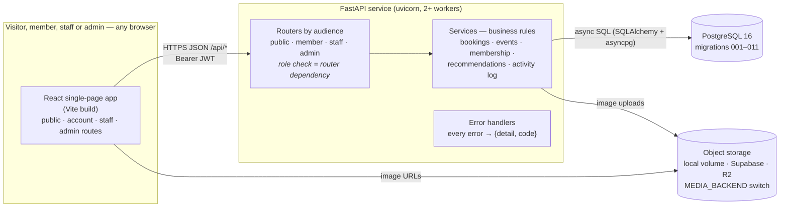

# System architecture

| Layer | Technology | Responsibility |
|---|---|---|
| Front end | React 19, React Router 7, Vite | All screens; talks to the API only through `src/api/` (one client, one error shape). `RoleGuard` hides screens a role can't use — convenience, not security. |
| API | FastAPI, Pydantic 2, python-jose (JWT), bcrypt | Validation, authentication, **authorisation on every route**, business rules in `app/services/`, contract-shaped errors. |
| Database | PostgreSQL 16 | System of record. Plain SQL migrations in `database/migrations/`, applied in order by `scripts/apply_migrations.sh`. |
| Media | Local docker volume (default), Supabase Storage or Cloudflare R2 | Staff uploads; one backend active at a time (`docs/design/media-storage.md`). |
| Packaging | Docker Compose (local), `infra/Dockerfile.*` | One command brings up db + API + front end. |
| CI | GitHub Actions | Backend unit + integration tests on a real Postgres; front-end lint, tests, build; deploys the `dev` front end to Cloudflare Pages. |

## Request lifecycle — a staff member publishes an event

1. The browser sends `PATCH /api/staff/events/12 {status: "published"}` with
   the access token.
2. The staff router's dependency decodes the token, loads the account from
   the database and checks its **current** role (staff or admin) — a
   demoted account is refused immediately.
3. `event_service.update` validates the change and writes it.
4. `activity_service.record` writes *Event published* to `activity_log`.
5. The response is the updated event; the public `GET /api/events` now
   includes it, and members whose interests match see it in
   recommendations.

## Security boundaries

- Passwords are bcrypt-hashed; tokens are signed (HS256) and short-lived.
- Roles come from `user_role`, never from the token's claims.
- Every write path is under `/api/staff` or `/api/admin` with a router-level
  role dependency; there is no client-authored content (Q10).
- Another account's booking or registration reads as 404.
- CORS is limited to the configured front-end origin.
